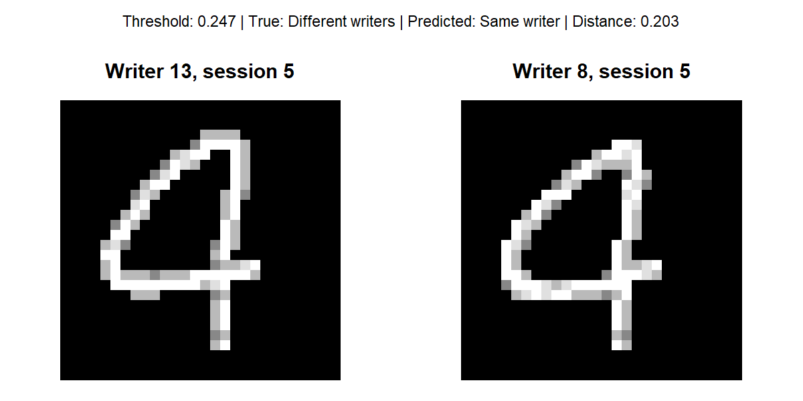
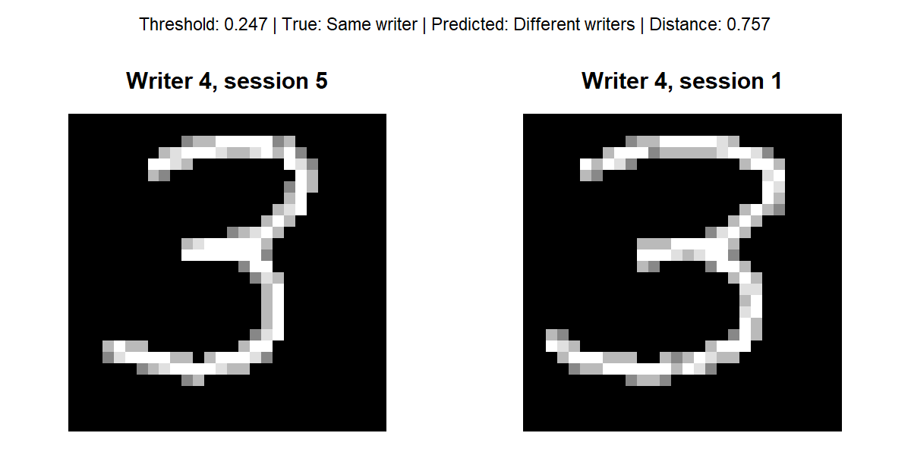

# Introduction

This study utilizes a simulated data set of 25,000 handwritten digits collected from 20 participants. Each individual provided 1,250 samples split across 5 sessions, with 50 samples recorded per session. Handwritten samples naturally exhibit intra-writer variability due to inherent personal differences and changing environmental conditions, such as time constraints during exams compared to relaxed note-taking. Nevertheless, underlying individual traits remain consistent, enabling writer identification.

To investigate this data set, we address two core questions: first, whether we can identify a writer across different sessions, and second, whether we can determine if two arbitrary handwritten digits belong to the same person.

To investigate the first research question, we will construct a Convolutional Neural Network (CNN) designed to classify handwritten digit images and assign them to one of the 20 individuals in the data set. To explore the second question, we will develop a Siamese neural network to determine whether two given images originate from the same writer or different writers. Finally, these two models will be evaluated and compared to establish which architecture yields superior performance in terms of accuracy and precision.

# Data Splitting

To build and evaluate our models, the data set is partitioned into three distinct subsets: a training set used to construct the models, a validation set used to evaluate performance and tune hyper-parameters, and a test set for final assessment. Rather than splitting randomly, the data is partitioned by session: **Sessions 1 to 3** form the training set, **Session 4** serves as the validation set, and **Session 5** comprises the test set.

This session-based partitioning is intentional. Because the objective is to recognize each person's handwriting across different writing conditions, every participant must be represented in the training data. Furthermore, because both the Convolutional Neural Network (CNN) and the Siamese network are evaluated and compared directly against one another, maintaining a consistent data split ensures a fair performance comparison across both architectures.

# Exploratory Data Analysis

The aim of this section is to explore the handwriting images and metadata, compare examples across people, digits and sessions, and identify visible sources of variation and limitations of the simulated data.

```{r}
#| include: false
library(dplyr)
library(knitr)

data <- readRDS("handwriting.rds")
meta <- data$metadata
X <- matrix(data$images, nrow = 25000) / 255
images <- data$images
set.seed(5073)

# One row per image; the image array is assumed to be ordered like metadata.
stopifnot(dim(images)[1] == nrow(meta))

display_image <- function(img, title = "") {
  # Accept either a 28 x 28 matrix or a 28 x 28 x 1 array.
  if (length(dim(img)) == 3) img <- img[, , 1]
  image(t(img)[, ncol(img):1],
        col = gray.colors(256), axes = FALSE, main = title)
}
```

## Data set and Metadata Overview

::: {#tbl-dataset_summary}
| Metadata Attribute | Value / Description |
|:-----------------------------------|:-----------------------------------|
| Person ID Range (`person_id`) | 1 - 20 (20 unique subjects) |
| Session ID Range (`session`) | 1 - 5 (5 distinct sessions) |
| Digit Classes (`digit`) | 0 - 4 (5 classes) |
| Total Dataset Size ($N$) | 25000 images |
| Image Resolution (Height x Width) | 28 pixels x 28 pixels |
| Color Channels | 28 Channel(s) |
| Class Distribution (Digits 0 to 4) | Balanced (5000, 5000, 5000, 5000, 5000 samples each) |

Table. Summary of Dataset Metadata and Image Dimensions
:::

The metadata identify the writer (`person_id`), the digit class (`digit`), and the recording session (`session`). These variables allow us to compare writers while holding the digit and session fixed, compare sessions for the same writer and digit, and compare different digits written by the same person.

## Quantitative meta data analysis

::: {#tbl-variance_decomposition}
|     | Digit | Person ID | Session | Person ID : Session | Residuals |
|:----|------:|----------:|--------:|--------------------:|----------:|
| h   |   7.6 |      62.9 |     0.1 |                 2.9 |      26.5 |
| w   |  43.5 |      40.5 |     0.4 |                 6.8 |       8.8 |
| cx  |  31.6 |      34.4 |     0.6 |                10.3 |      23.1 |
| cy  |  15.0 |      10.3 |     0.4 |                17.0 |      57.3 |

Table. Percentage of Variance Decomposition for Features
:::

To evaluate the stability and discriminative power of spatial feature measurements across handwritten digit samples, a variance decomposition analysis was conducted. The analysis decomposes total variance across four spatial metrics into five distinct components:

- **Feature Metrics:** Digit height ($h$), digit width ($w$), horizontal center of mass ($cx$), and vertical center of mass ($cy$).

- **Variance Components:** Digit identity (**Digit**), writer identity (**Person ID**), baseline session main effect (**Session**), writer-by-session interaction (**Person ID : Session**), and random residual variation across replicates (**Residuals**).

#### Feature Interpretation

- **Digit Height (**$h$): Writer identity (**Person ID**) accounts for the dominant share of variance at **62.9%**, whereas the interaction effect (**Person ID : Session**) accounts for only **2.9%**. This demonstrates that character height serves as a highly stable, writer-specific trait that remains robust across distinct recording sessions.

- **Digit Width (**$w$): Total variance is primarily partitioned between digit identity (**43.5%**) and writer identity (**40.5%**). Naturally, character width varies intrinsically across different digits (e.g., a digit '1' versus a digit '0'); nevertheless, substantial inter-writer variance persists with minimal session-induced fluctuation (**6.8%**).

- **Horizontal Position (**$cx$): Influenced moderately by both digit identity (**31.6%**) and writer identity (**34.4%**). Individual writers maintain consistent horizontal placement habits, though a moderate writer-by-session interaction (**10.3%**) indicates minor positional shifts across recording instances.

- **Vertical Position (**$cy$): Exhibits poor stability for writer discrimination. Main writer variance accounts for only **10.3%**, whereas writer-by-session interaction (**17.0%**) and residual noise (**57.3%**) dominate total variance. Consequently, vertical alignment varies substantially between sessions and individual stroke replicates, making it an unreliable feature for writer identification.

Overall, the variance decomposition yields several key insights regarding feature stability and writer discriminability. Main session effects contribute less than 1% across all spatial metrics (0.1%–0.6%), indicating that no single recording session exhibits global systematic bias or baseline shift, which supports the assumption that sessions represent comparable sampling conditions. Furthermore, inter-individual variance (**Person ID**) constitutes a major proportion of total variation for height, width, and horizontal positioning, confirming that individual writers possess measurable, repeatable handwriting characteristics that generalize across distinct sessions. Finally, handwriting variations between sessions manifest primarily as spatial positional shifts ($cx, cy$) rather than structural or dimensional resizing ($h, w$).

### Euclidean Distance Analysis

::: {#tbl-euclidean_distances}
|                            | Digit 0 | Digit 1 | Digit 2 | Digit 3 | Digit 4 |
|:---------------------------|--------:|--------:|--------:|--------:|--------:|
| `same_writer_diff_session` |    7.06 |    6.48 |    6.58 |    6.65 |    6.35 |
| `diff_writer_same_session` |    8.78 |    7.85 |    8.09 |    8.17 |    7.98 |
| `diff_writer_diff_session` |    8.79 |    7.85 |    8.10 |    8.18 |    7.98 |
| Ratio (Same/Diff Writer)   |    0.80 |    0.83 |    0.81 |    0.81 |    0.80 |

Table. Euclidean Distances and Ratios Across Digits (0 to 4)
:::

Because distances are measured in pixel units, relative comparisons across conditions are more informative than absolute values (see Table 2). Across all digits (0 to 4), the mean Euclidean distance for the same writer across different sessions ($6.35$–$7.06$ pixels) is consistently smaller than between different writers ($7.85$–$8.79$ pixels), establishing the core signal required for writer identification.

However, this distinction is moderate. The ratio of same-writer to different-writer distance ranges tightly between $0.80$ and $0.83$ across all digits, showing that session-to-session variation accounts for roughly $80\%$ of the distance to another writer's sample. Additionally, distances between different writers are virtually identical within the same session ($7.85$–$8.78$) and across different sessions ($7.85$–$8.79$). This confirms the absence of a shared session effect, directly supporting previous variance decomposition findings ($<1\%$ session variance) and validating the decision to hold out entire sessions for testing.

## Variation between people

Firstly, we will compare all 20 peoples handwriting across one session. The main goal of this exercise is to check whether there are any visible variations among peoples handwriting within a particular session. The first image will compare the people writing the digit 0 in session 1.

```{r}
#| include: false
people_examples <- data$metadata %>%
  filter(
    digit == 0,
    session == 1
  ) %>%
  group_by(person_id) %>%
  slice_sample(n = 1) %>%
  ungroup()
```

```{r fig-digit-0, fig.cap= "People writing the digit 0"}
#| echo: false
par(
  mfrow = c(4, 5),
  mar = c(0.25, 0.25, 1, 0.5)
)

for (i in 1:nrow(people_examples)) {
  
  image_id <- people_examples$image_id[i]
  person <- people_examples$person_id[i]
  
  display_image(
    data$images[image_id,,,],
    paste("Person", person)
  )
}

par(mfrow = c(1, 1))
```

From the image above we can see that there are different variations in the way people write the digit zero in the first session. Some peoples zeros are more elongated while others look more rounded. The size of the digit differs from person to person. The digits are tilted in different directions, some peoples zero are tilted to the left while others are tilted to the right.

For a more accurate prediction we will compare the between person variation for a different image in the same session. For this we will now compare the between person variation in session one for the digit 1.

```{r}
#| include: false


people_examples_1 <- data$metadata %>%
  filter(
    digit == 1,
    session == 1
  ) %>%
  group_by(person_id) %>%
  slice_sample(n = 1) %>%
  ungroup()
```

```{r fig-digit-1, fig.cap= "People writing the digit 1"}
#| echo: false
par(
  mfrow = c(4, 5),
  mar = c(0.25, 0.25, 1, 0.25)
)


for (i in 1:nrow(people_examples_1)) {
  
  image_id <- people_examples_1$image_id[i]
  person <- people_examples_1$person_id[i]
  
  display_image(
    data$images[image_id,,,],
    paste("Person", person)
  )
}

par(mfrow = c(1, 1))
```

In the image above we can see the that there are clear stylistic differences in the peoples handwriting. A visual comparison shows that some of the digits are more elongated than others. There is a clear difference in the way person 3 and person 20 wrote the same digit. Out of all the people, person 18 wrote a digit that tilts most to the right.

### Variation across sessions for one person

Next we will explore is if there is variation within a persons handwriting. To do this we will randomly select 3 people and we will compare their handwriting across the five different sessions. This particular section is important because later we will build a Siamese network that will compare whether two images were written by the same person or not. A preliminary analysis will visually help us determine if there are similarities within a persons handwriting.

```{r fig-variation-0, fig.cap= "Variation between person 1, 8 and 18 for the digit 0"}
#| label: Digits in each session
#| echo: false
d <- 0
selected_persons <- c(1, 9, 18)

par(mfrow = c(length(selected_persons), 5), mar = c(0.5, 0.5, 1, 0.5))

for (p in selected_persons) {
  for (s in 1:5) {
    # Find the index matching the person, digit, and session
    matching_indices <- which(meta$person_id == p & meta$digit == d & meta$session == s)
    
    if (length(matching_indices) > 0) {
      i <- matching_indices[1]
      image(t(data$images[i,,,1])[, 28:1], axes = FALSE, col = gray.colors(256),
            main = paste("Person", p, "| S", s))
    } else {
      # Plot an empty blank space if a specific combination is missing
      plot.new()
      title(main = paste("Person", p, "| S", s))
    }
  }
}

# Reset plotting parameters back to default
par(mfrow = c(1, 1))
```

A visual examination of handwriting for the digit '0' across five sessions reveals distinct, highly consistent stylistic characteristics within individual writers. Person 1 consistently produces a rounded digit featuring a noticeably flattened, vertical edge along the left side. In contrast, Person 9 exhibits a centered, overall rounded digit structure across all sessions. Finally, Person 18 displays an elongated, oval-shaped digit that is systematically tilted to the right. Despite slight session-to-session variations, each writer maintains a clear, unique visual signature across all five sessions.

## Variation across digits for one person

Finally, we will assess the within person variation of the different digits. The main goal of this is to assess whether there are similarities between a persons handwriting for different digits. This section is important because the Siamese and CNN networks will be tasked identifying similarities within the different digits.

For this section we will use the same three people from the previous section. We will keep the session constant and we will assess them on session one.

```{r fig-all_digits, fig.cap= "Variation for person 1, 9, 18 across all the digits"}
#| echo: false
s <- 1
selected_persons <- c(1, 9, 18)

# Set up a plotting grid: 3 rows (one for each person) and 5 columns (for the 5 sessions)
par(mfrow = c(length(selected_persons), 5), mar = c(0.5, 0.5, 1, 0.5))

for (p in selected_persons) {
  for (d in 0:4) {
    # Find the index matching the person, digit, and session
    matching_indices <- which(meta$person_id == p & meta$digit == d & meta$session == s)
    
    if (length(matching_indices) > 0) {
      i <- matching_indices[1]
      image(t(data$images[i,,,1])[, 28:1], axes = FALSE, col = gray.colors(256),
            main = paste("Person", p, "| S", s))
    } else {
      # Plot an empty blank space if a specific combination is missing
      plot.new()
      title(main = paste("Person", p, "| S", s))
    }
  }
}

# Reset plotting parameters back to default
par(mfrow = c(1, 1))
```

Across all digits, a visual evaluation reveals distinctive structural and geometric features that define each individual's overall writing style. Person 1 produces centered digits occupying consistent relative proportions, where digits 1, 2, and 3 share a similar curved, arch-like top loop, and digits 1 and 2 feature flat horizontal base strokes. Similarly, Person 9 exhibits overlapping structural traits across digits, including a smoothly curved top arch across digits 1, 2, and 3, flat horizontal base strokes on digits 1 and 2, and enclosed loop structures within digits 0 and 4. In contrast, Person 18 displays strong slanted and angular characteristics, with digits 1 through 4 featuring pronounced rightward slants and sharp, linear strokes rather than smooth curves, alongside flat horizontal baselines (digits 1 and 2) and sharp horizontal cross-strokes across digits 1, 2, and 4.

## Data Limitations and Potential Problems

There some limitations with the data and this may cause potential problems when we are building our prediction models. Firstly, the data we are using is simulated and images do not contain real handwriting, the data lacks the organic irregularities, noise complexities, and unpredictable strokes found in real world handwriting. Secondly, the data set is constrained to five digits. It does not cover the full range of numeric digits or alphabet characters which limits how well the findings generalize to full handwriting recognition tasks.

Another potential issue with the data is the rigid structure and balance of the data. The data set has a well balanced structure which lacks the organic class imbalances and variable sample sizes typically characteristics of real world data collection. The variation in the independent sessions are artificially bounded into 5 discrete blocks rather than capturing a continuous, organic evolution pf a persons handwriting over time. Lastly, the resolution in the pixels is relatively low thus fine structural details, subtle pen-pressure changes, and intricate loop formations may be lost or pixeleted.

These problems have the potential to cause over fitting in the models. The way the data is structured has the potential to over inflate the accuracy during training and validation. Since the images are low resolution, the models can easily over fit to pixel-level noise or minor rendering artifacts introduced by the simulation engine, treating random pixel patterns as meaningful writer features rather than focusing on the actual stroke dynamic and shapes.

# Methods and Results

All analyses were conducted in R (R Core Team, 2026), and used the following packages:

- keras3 (Kalinowski et al., 2026) for neural network model building and training\
- tidyverse (Wickham et al., 2019) for convenient data manipulation\
- imager (Barthelme, 2025) for image processing and manipulation\
- pROC (Xavier et al., 2011) for calculation of the area under the curve\
- reticulate (Kalinowski et al., 2026) for interfacing between R and Python, enabling the use of the TensorFlow backend 

Seeds were set throughout the analyses to ensure reproducibility of results. 


\newpage

## Convolutional Neural Network

A convolutional neural network (CNN) was built to answer the first research question: can a writer be identified from a single handwritten digit? Each image is assigned to one of the 20 writers, whatever digit it shows, so the digit is neither an input nor a label. The network outputs one probability per writer (a softmax layer) and the predicted writer is the one with the highest probability. Pixel values were divided by 255, and the training, validation and test sessions are those described under Data Splitting. Training used categorical cross-entropy loss, the Adam optimiser and batches of 64 images.

**Architecture.** The network has two convolutional layers (16 filters of 3 $\times$ 3 each, followed by an activation function), dropout after the first convolutional layer, 2 $\times$ 2 max pooling, a flatten layer and a 20-unit softmax output layer. This gives 48,580 trainable parameters, 95% of them in the output layer. When an L2 penalty is used, it is applied to the weights of both convolutional layers and the output layer.

**Reference models.** Three other models give context for the results. The *default CNN* has the same architecture with the settings of the course example (ReLU, dropout 0.2, learning rate 0.01, no penalty). The *nearest-centroid classifier* averages each writer's training images of a digit into a template and assigns a new image to the writer whose template for that digit is closest. The *linear model* is a softmax regression on the 784 pixels, with no hidden layer. The linear model's learning rate and number of epochs were set from its own validation curves, so it is lightly tuned.

**Tuning.** All settings of the final CNN were chosen on the validation session only (session 4), in four stages, with three random seeds per candidate:

1.  activation function (tanh or ReLU), learning rate (0.003 down to 0.00001) and dropout rate (0.1 to 0.7): 72 combinations, ranked on validation accuracy and on validation cross-entropy, with the two ranks added;
2.  number of filters (8, 16 or 32), kernel size (3 or 5) and pool size (2 or 3): 12 combinations, choosing the highest accuracy among those whose cross-entropy was within 30% of the best;
3.  number of epochs, from the validation curves, with the same 30% rule;
4.  the L2 penalty $\nu$, over eight values from 0 to 0.3, using the value after the one with the lowest cross-entropy, which favours the simpler model.

Cross-entropy was computed from the predicted probabilities without the penalty term, so it can be compared across penalties. Accuracy and cross-entropy preferred different settings in the first stage, and the rank rule was chosen after seeing that, so it is partly a judgement.

**Evaluation.** The final model was fixed before the test session (session 5) was scored. Performance is reported as accuracy, cross-entropy, and per-writer recall and precision. Every writer has 250 test images, so accuracy equals the average per-writer recall (balanced accuracy). The 50 replicates of a digit by one writer in one session are near-duplicates, so the effective sample is about 100 writer-digit cells per session and not 5,000 images, and intervals were obtained by resampling writers.

### Results

**Tuning.** The first stage favoured tanh with a learning rate of 0.0001 and dropout 0.7 (validation accuracy 59.1% and cross-entropy 1.89, averaged over three seeds). A smaller learning rate (0.00003) gave a lower cross-entropy (about 1.5) but a lower accuracy (about 56%), and dropout rates between 0.5 and 0.7 could not be told apart. In the second stage, the default layout (16 filters of 3 $\times$ 3, 2 $\times$ 2 pooling) had the highest validation accuracy among the architectures inside the cross-entropy tolerance, so it was kept. Validation cross-entropy was lowest after 4 epochs and rose afterwards, while training accuracy approached 100%; 10 epochs was chosen as the point of highest accuracy among the epochs inside the tolerance. The penalty has a U-shaped effect (@tbl-cnn-nu): cross-entropy fell from 1.89 without a penalty to 1.39 at $\nu = 0.03$ and rose again, and at $\nu = 0.3$ the model could not learn. The value used was $\nu = 0.1$. @tbl-cnn-settings lists the final settings.

```{r}
#| label: tbl-cnn-settings
#| echo: false
#| tbl-cap: "Settings of the default and the tuned CNN. Both have the same architecture and 48,580 parameters."
settings <- data.frame(
  Setting = c("Activation", "Dropout rate", "Learning rate", "L2 penalty",
              "Filters per layer", "Kernel size", "Pool size", "Epochs"),
  Default = c("ReLU", "0.2", "0.01", "none", "16", "3 x 3", "2 x 2", "10"),
  Tuned   = c("tanh", "0.7", "0.0001", "0.1", "16", "3 x 3", "2 x 2", "10"))
kable(settings, booktabs = TRUE)
```

```{r}
#| label: tbl-cnn-nu
#| echo: false
#| tbl-cap: "Effect of the L2 penalty on the validation session (mean of three seeds, 10 epochs)."
nu_tab <- data.frame(
  nu = c("0", "0.0001", "0.001", "0.003", "0.01", "0.03", "0.1", "0.3"),
  `Training accuracy` = c(0.979, 0.979, 0.979, 0.979, 0.975, 0.957, 0.862, 0.165),
  `Validation accuracy` = c(0.591, 0.592, 0.591, 0.593, 0.600, 0.606, 0.612, 0.135),
  `Validation cross-entropy` = c(1.892, 1.885, 1.829, 1.727, 1.529, 1.392, 1.447, 2.986),
  check.names = FALSE)
nu_tab <- nu_tab[!(nu_tab$nu %in% c("0.0001", "0.001")), ]
kable(nu_tab, booktabs = TRUE, row.names = FALSE,
      col.names = c("$\\nu$", "Training accuracy", "Validation accuracy", "Validation cross-entropy"),
      escape = FALSE)
```

On the validation session, the default CNN reached a training accuracy of 99.4% and a validation accuracy of 44.8%, a gap of 55 points: it memorises the training sessions. The tuned CNN reached 86.0% and 60.4%, a gap of 26 points. The two models have the same architecture, so the improvement comes from the four changed settings together (activation, dropout, learning rate and penalty). The validation score of the tuned CNN is optimistic, because its settings were selected on this session.

**Test performance.** On the held-out session, the tuned CNN identified the writer for 55.0% of the images, against 5% expected by chance with 20 writers (@tbl-cnn-test). A 95% interval obtained by resampling writers is 42.7% to 67.1%. The accuracy is lower than the validation accuracy (60.4%), as expected when settings are chosen on the validation session.

```{r}
#| label: tbl-cnn-test
#| echo: false
#| tbl-cap: "Test performance on session 5 (5,000 images, 250 per writer). Each figure comes from one trained model."
test_tab <- data.frame(
  Model = c("Nearest centroid", "Linear softmax", "Default CNN", "Tuned CNN (final model)",
            "Guessing evenly among 20 writers"),
  `Accuracy (%)` = c("47.3", "43.6", "49.3", "55.0", "5.0"),
  `Cross-entropy` = c("-", "-", "5.87", "1.39", "3.00"),
  check.names = FALSE)
kable(test_tab, booktabs = TRUE, align = "lrr")
```

Because all models are scored on the same 20 writers, they were compared in pairs, resampling writers. The tuned CNN scored 11.4 percentage points higher than the linear model (95% interval 4.1 to 18.9), so that difference is unlikely to be due to which writers were sampled. Its 5.7-point lead over the default CNN (interval $-1.9$ to 13.6) cannot be distinguished from zero, and the nearest-centroid classifier was not tested formally. The clearest difference between the two CNNs is in the probabilities: the tuned model's cross-entropy of 1.39 is below the 3.00 of guessing evenly, whereas the default CNN's 5.87 is about twice that value. The default model is overconfident: it is wrong about half the time, but gives high probability to its wrong answers. The linear baseline was only lightly tuned, so part of its deficit reflects tuning effort and not the convolutional structure.

**Writers and errors.** Accuracy varied enormously between writers (@fig-cnn-writer). Writers 7 and 18 were identified in every image, and writers 6, 8, 15 and 17 in 76% to 85% of their images, whereas writer 5 was never identified, writer 13 in only 1 of 250 images, and writers 10, 16 and 20 in fewer than 35%. The average per-writer precision was 54.3%. Writers 5 and 13 were also the hardest for a model with different settings, which suggests that the difficulty comes from the data and not from one model.

```{r}
#| label: fig-cnn-writer
#| echo: false
#| fig-cap: "Test accuracy (recall) and precision of the tuned CNN for each writer. The dashed line is the 5% expected by chance."
#| fig-height: 3.6
recall    <- c(0.396, 0.576, 0.424, 0.404, 0.000, 0.840, 1.000, 0.764, 0.596, 0.292,
               0.676, 0.656, 0.004, 0.508, 0.796, 0.344, 0.852, 1.000, 0.600, 0.272)
precision <- c(0.343, 0.314, 0.731, 0.605, 0.000, 0.814, 0.628, 0.508, 0.603, 0.537,
               0.610, 0.594, 0.005, 0.599, 0.686, 0.637, 0.842, 1.000, 0.556, 0.249)
par(mar = c(4, 4, 1, 1))
mids <- barplot(rbind(recall, precision), beside = TRUE, names.arg = rep("", 20),
                col = c("grey30", "grey75"), ylim = c(0, 1.25), yaxt = "n",
                xlab = "Writer (person_id)", ylab = "Proportion")
axis(1, at = colMeans(mids), labels = 1:20, tick = FALSE, cex.axis = 0.8, line = -0.5)
axis(2, at = seq(0, 1, 0.2), las = 1)
abline(h = 0.05, lty = 2)
legend("top", c("Recall (accuracy)", "Precision"), fill = c("grey30", "grey75"),
       bty = "n", horiz = TRUE, cex = 0.8)
```

The errors are concentrated in particular pairs of writers, not spread evenly. Seventy-one per cent of writer 10's images (177) were labelled as writer 2, 60% of writer 5's (150) as writer 13, and 40% of writer 16's (100) as writer 1. Some confusions run in both directions (writers 1 and 16, 14 and 15, and 6 and 17), which may mean that the two writers' handwriting is similar, although this was not checked. The model also over-assigns a few writers: writer 2 received 459 predictions, of which only 144 (31%) were correct, and writer 7 received 398 (63% correct), against a fair share of 250. Many counts are close to 50, 100 or 150, the size of one or more writer-digit cells of near-identical images, so the model tends to assign a whole cell to a single writer. Accuracy was similar for all five digits (50% to 59%), with no digit clearly easier.

These results agree with the exploratory analysis. Writers differ in measurable ways, but a writer's average digit in another session was only about 20% closer to their own earlier sessions than to another writer's handwriting (distance ratio about 0.8), so a new session often resembles another writer's training data.

**Comparison with the Siamese network.** The two networks answer different questions: the CNN identifies the writer of one image among 20, and the Siamese network decides whether two images have the same writer. Their metrics (accuracy over 20 classes, and balanced accuracy over pairs) are therefore not directly comparable. The evaluations also differ: every CNN test image comes from a session that was never used in training, whereas the Siamese cross-session test pairs reuse images from the training sessions, as noted in that section.

**Limitations.** Validation and test scores rest on about 100 writer-digit cells each, so differences of a few points between models are within noise. The settings were chosen in stages, which ignores interactions between them, and every stage is another look at the validation session, so the validation scores of the tuned CNN are optimistic. The comparisons between models rest on one training run per model: the intervals reflect which writers were sampled, not variation between random starts. The baselines received less tuning than the CNN. Finally, a test result from an earlier configuration was seen before the tuning was redone, and no setting was chosen using the test session.

\newpage

## Siamese Neural Network

A siamese neural network was implemented, with the aim of predicting if 2 images were written by the same person. The data set was initially split into its training (sessions 1 to 3), validation (session 4) and test (session 5) subsets. Within the training subset and validation subset, images were arranged into pairs. Each image could be part of more than 1 pair. Pairs had a 50% chance of both images having the same writer. To remove unnecessary complexity, all pairs were ensured to have 2 images portraying the same digit.

Contrastive loss was implemented, and is calculated as $$L = yD^2 + (1-y)\text{max}(0, m - D)^2,$$ where y = 1 if the images are written by the same writer, D is the euclidean distance between the 2 image embeddings, and m = 1 is the margin. Balanced accuracy is calculated as the average of the true positive rate (sensitivity) and the true negative rate (specificity):
$$\text{Balanced Accuracy}
=
\frac{\text{Sensitivity}+\text{Specificity}}{2}$$
where
$$\text{Sensitivity}
=
\frac{\text{True Positives}}
{\text{True Positives}+\text{False Negatives}}$$
and
$$\text{Specificity}
=
\frac{\text{True Negatives}}
{\text{True Negatives}+\text{False Positives}}.$$
The distance threshold was chosen by maximizing balanced accuracy for that individual model. All the calculated distances were candidates for the threshold. Furthermore, hyperparameters were tuned and chosen according to which values and combinations thereof that produced the model with the highest balanced accuracy. For each combination of parameters considered, the model fitting process was repeated 3 times, and the average metrics were reported.

It was found that a model with 2 hidden layers (mean balanced accuracy = 0.966 and mean validation loss = 0.105) performed considerably better than a model with 1 (balanced accuracy = 0.773 and validation loss = 0.214). Thereafter, the activation functions on the hidden layers were optimized. The ReLU and Tanh functions were considered. The 4 different combinations of these functions across the 2 layer network were evaluated. @tbl-act-fn_tune demonstrates that the best performing activation function combination was relu-tanh according to balanced accuracy (0.982). Though this does not correspond with the activation function combination chosen by validation loss (tanh-relu, 0.103), the balanced accuracy metric is prioritized throughout tuning. This is because balanced accuracy provides a direct measure of classification performance by averaging sensitivity and specificity. This ensures that performance on both classes (similar and dissimilar image pairs) is considered equally, regardless of class prevalence. In contrast, validation contrastive loss measures how effectively the network learns the distance relationships between image pairs, but does not directly indicate classification accuracy. Therefore, balanced accuracy was considered a more appropriate criterion for tuning the model.

::: {#tbl-act-fn_tune}
|                   | relu_relu | tanh_relu | relu_tanh | tanh_tanh |
|:------------------|----------:|----------:|----------:|----------:|
| Balanced accuracy |     0.966 |     0.971 |     0.982 |     0.980 |
| Validation loss   |     0.105 |     0.103 |     0.108 |     0.113 |

Table. Model performance (averaged across 3 repetitions) using different combinations of the relu and tanh activation functions in the 2 hidden layers. The column names follow the naming convention of the first activation function name being applied to the first hidden layer, and the second activation function name being applied to the second hidden layer.
:::

Thereafter, the number of filters and their sizes were also tuned. Three numbers of filters were considered (16, 32 and 64) and 3 sizes of filters were considered (3x3, 5x5 and 7x7). Only square filters were considered for simplicity. The filter counts were as mentioned for the first hidden layer, and double thereof for the second hidden layer. @tbl-filter_tune shows that all combinations of the filter numbers and sizes achieve a validation balanced accuracy above 95%.

The best-performing model (16 filters of size 5 x 5, with a balanced accuracy of 0.991) achieved the highest balanced accuracy, while the model with 16 filters of size 7 x 7 achieved the lowest validation loss (0.065). Although the model with 16 filters of size 7 x 7 has a marginally lower balanced accuracy (0.990), the difference is only 0.1%. Therefore, the choice between these models depends on whether classification performance or validation loss is prioritized. Since balanced accuracy is the primary metric throughout tuning, the model with 16 filters of size 5 x 5 is preferred, although the model with 16 filters of size 7 x 7 may also be considered given its lower validation loss.

In general, 64 filters of size 3 x 3 result in the worst-performing model, with the lowest balanced accuracy (0.952) and the highest validation loss (0.115). Filter size appears to matter more than filter count: across all three filter counts, the 3 x 3 filters consistently result in lower balanced accuracy than the 5 x 5 and 7 x 7 filters. This suggests that larger filters may capture more useful spatial patterns. As shown in @fig-filter-tuning, the larger kernel sizes generally achieve lower validation loss and higher balanced accuracy. However, increasing the number of filters does not consistently improve performance; for a given kernel size, models with fewer filters generally perform better or comparably to those with more filters.

::: {#tbl-filter_tune}
| n_filters | kernel_size | val_loss | balanced_accuracy |
|----------:|------------:|---------:|------------------:|
|        16 |           3 |    0.108 |             0.982 |
|        32 |           3 |    0.109 |             0.971 |
|        64 |           3 |    0.115 |             0.952 |
|        16 |           5 |    0.071 |             0.991 |
|        32 |           5 |    0.072 |             0.989 |
|        64 |           5 |    0.073 |             0.987 |
|        16 |           7 |    0.065 |             0.990 |
|        32 |           7 |    0.066 |             0.989 |
|        64 |           7 |    0.068 |             0.987 |

Table. The number of filters and their sizes were tuned. The models was run for 15 epochs and evaluated. The average performance metrics across 3 repetitions are presented.
:::

```{r, echo=FALSE}
grid_filter_results <- data.frame(
  n_filters = c(16, 32, 64, 16, 32, 64, 16, 32, 64),
  kernel_size = c(3, 3, 3, 5, 5, 5, 7, 7, 7),
  val_loss = c(
    0.10828044, 0.10871494, 0.11457483,
    0.07125929, 0.07157875, 0.07282596,
    0.06522755, 0.06599005, 0.06844446),
  balanced_accuracy = c(
    0.9822069, 0.9711410, 0.9524663,
    0.9912090, 0.9894468, 0.9870222,
    0.9902915, 0.9887943, 0.9870406))


#par(mfrow = c(2, 3), mar = c(4, 4, 3, 1))

kernel_sizes <- sort(unique(grid_filter_results$kernel_size))

# Common y-axis limits for each metric
acc_ylim <- range(grid_filter_results$balanced_accuracy, na.rm = TRUE)
loss_ylim <- range(grid_filter_results$val_loss, na.rm = TRUE)
```

```{r fig-filter-tuning, fig.cap="Evaluating models that were fit using different filter (kernel) sizes and filter counts.", echo=FALSE}
par(mfrow = c(2, 3), mar = c(4, 4, 3, 1))

for (k in kernel_sizes) {
  
  dat <- grid_filter_results[
    grid_filter_results$kernel_size == k, ]
  
  # Balanced accuracy (top row)
  plot(
    dat$n_filters, dat$balanced_accuracy,
    type = "b", pch = 19,
    xlab = "Number of filters",
    ylab = "Mean Balanced accuracy",
    main = paste("Kernel size =", k),
    ylim = acc_ylim,
    xaxt = "n"
  )
  axis(1, at = dat$n_filters)
}

for (k in kernel_sizes) {
  
  dat <- grid_filter_results[
    grid_filter_results$kernel_size == k, ]
  
  # Validation loss (bottom row)
  plot(
    dat$n_filters, dat$val_loss,
    type = "b", pch = 19,
    xlab = "Number of filters",
    ylab = "Mean Validation loss",
    main = paste("Kernel size =", k),
    ylim = loss_ylim,
    xaxt = "n"
  )
  axis(1, at = dat$n_filters)
}

# Reset plotting layout
par(mfrow = c(1, 1))


```

Since validation balanced accuracy and error was already quite impressive, tuning of the other parameters (such as learning rate, dropout rate and the regularization parameter) was deemed unnecessary. The above (tuning) models used default values of 0.0001, 0.2 and 0.001 for the learning rate, dropout rate and the regularization parameter respectively. These inputs were retained. Hence, the final model used the above default values, one hidden layer with a relu activation and 16 filters of size 5x5, a tanh on the second hidden layer with 32 filters of size 5x5, and was trained using 6 epochs. The number of epochs decreased from 15 to 6 since values converge earlier on, rendering almost half of the epochs unnecessary (@fig-siamese-1-layer-epochs, Appendix).

To extensively evaluate the final model, a comprehensive test set was constructed, consisting of 1,000 image pairs for each of the following writer–session combinations: same writer–same session, same writer–different sessions, different writers–same session, and different writers–different sessions. Each of the 2 images in a pair contained the same digit, and the 5 digits featured amongst the thousand pairs in each category. Since only session 5 was held out for testing, pairs involving different sessions were constructed using images from sessions 1–4. Although the individual images in these pairs had been encountered during training, the specific combinations of images had not been seen by the model. The test pairs therefore still provided a valid assessment of the model's ability to generalize to unseen pairwise comparisons, particularly its ability to distinguish between similar and dissimilar images under different writer–session conditions. However, this evaluation does not constitute a fully independent assessment of generalization to unseen images, since the images themselves were present in the training data. Consequently, the results should be interpreted as evidence of generalization to unseen image pairs rather than to entirely unseen data.

### Results

The optimal distance threshold was found to be 0.247, meaning that 2 images with a difference less than 0.247 were classified as being written by the same person.

@tbl-results-session shows the model performed very well on pairs from the same session, achieving a balanced accuracy of 94.7%. However, performance decreased substantially for pairs from different sessions, with a balanced accuracy of 55.4%. This difference was primarily driven by very low sensitivity (11.2%), indicating that the model struggled to correctly identify similar pairs across sessions. In contrast, specificity remained very high at 99.7%, suggesting that the model was effective at identifying dissimilar pairs regardless of session.

::: {#tbl-results-session}
| session_type      |    n | accuracy | sensitivity | specificity | balanced_accuracy |
|:-----------|-----------:|-----------:|-----------:|-----------:|-----------:|
| Same session      | 2000 |    0.947 |       0.899 |       0.995 |             0.947 |
| Different session | 2000 |    0.554 |       0.112 |       0.997 |             0.554 |

Table. Test performance of the Siamese network based on same and different sessions.
:::

@tbl-results-writer-session displays the results segregated into writer-session combinations. Sensitivity, specificity and balanced accuracy could not all be calculated for each of the four writer–session combinations because the test pairs within each combination belonged exclusively to one true class. The same-writer combinations contained only pairs written by the same individual, whereas the different-writer combinations contained only pairs written by different individuals. Consequently, sensitivity could be calculated for the same-writer combinations, but specificity was undefined. Conversely, specificity could be calculated for the different-writer combinations, but sensitivity was undefined. Since balanced accuracy is the average of sensitivity and specificity, it could not be calculated for any individual writer–session combination. Accuracy was therefore used to compare classification performance across the four combinations, while sensitivity, specificity and balanced accuracy were calculated for the broader session-based groups, which contained both same-writer and different-writer pairs.

The model achieved very high accuracy for pairs of images from the same session, regardless of whether the images belonged to the same writer. Accuracy was 89.9% for the same-writer, same-session combination and 99.5% for different-writer, same-session pairs (@fig-siamese-error1 in the Appendix shows an example of an incorrect prediction for different writer, same session). Similarly, different-writer pairs from different sessions achieved 99.7% accuracy. However, accuracy dropped to 11.2% for the same writer across different sessions. This suggests that variation in handwriting between sessions posed a substantial challenge, even when the writer's identity remained unchanged. An example of an erroneous prediction can be seen in @fig-siamese-error2 (Appendix).

::: {#tbl-results-writer-session}
| pair_type                           |    n | correct | accuracy |
|:------------------------------------|-----:|--------:|---------:|
| Same writer, same session           | 1000 |     899 |    0.899 |
| Same writer, different session      | 1000 |     112 |    0.112 |
| Different writer, same session      | 1000 |     995 |    0.995 |
| Different writer, different session | 1000 |     997 |    0.997 |

Table. Classification accuracy across four combinations of writer identity and session.
:::

The model's performance was relatively consistent across the five digits (@tbl-results-digit), with accuracy ranging from 74.2% to 76.5% and balanced accuracy from 73.8% to 76.3%. Digit 1 achieved the highest balanced accuracy (76.3%), while digit 3 achieved the lowest (73.8%). Specificity was consistently high (99.2%–100%), whereas sensitivity was lower (47.6%–53.2%). This indicates that the model was generally effective at identifying pairs written by different writers, but was less effective at recognizing pairs written by the same writer. The similar performance across digits suggests that no single digit substantially outperformed the others, although the low sensitivity across all five digits highlights the model's difficulty in identifying the same writer, regardless of which digit was examined.

::: {#tbl-results-digit}
| digit | accuracy | sensitivity | specificity | balanced_accuracy |
|------:|---------:|------------:|------------:|------------------:|
|     0 |    0.742 |       0.501 |       0.995 |             0.748 |
|     1 |    0.765 |       0.532 |       0.995 |             0.763 |
|     2 |    0.763 |       0.513 |       0.998 |             0.755 |
|     3 |    0.742 |       0.476 |       1.000 |             0.738 |
|     4 |    0.743 |       0.510 |       0.992 |             0.751 |

Table. Test classification performance across the five handwritten digits
:::

Performance varied across writers (@tbl-results-writer). Writer 18 achieved the highest accuracy (80.3%) and balanced accuracy (80.6%), followed by writer 7, with a balanced accuracy of 79.3%. In contrast, writer 13 had the lowest accuracy (69%) and balanced accuracy (69.7%), followed by writer 8 with a balanced accuracy of 71%. Specificity was generally high across writers (98.3% - 100%), whereas sensitivity was lower, ranging from 40.3% for writer 13 to 61.3% for writer 18. This suggests that the model was generally effective at identifying pairs written by different writers but struggled to identify pairs written by the same writer. Although performance differed between writers, the consistently low sensitivity suggests that this limitation affected writer identification broadly. Further investigation would be required to determine the reasons for the observed differences.

::: {#tbl-results-writer}
| writer |   n | accuracy | sensitivity | specificity | balanced_accuracy |
|:-------|----:|---------:|------------:|------------:|------------------:|
| 1      | 212 |    0.769 |       0.538 |       0.991 |             0.765 |
| 2      | 177 |    0.718 |       0.432 |       1.000 |             0.716 |
| 3      | 218 |    0.752 |       0.481 |       1.000 |             0.740 |
| 4      | 216 |    0.750 |       0.518 |       1.000 |             0.759 |
| 5      | 168 |    0.732 |       0.476 |       0.988 |             0.732 |
| 6      | 210 |    0.710 |       0.444 |       0.990 |             0.717 |
| 7      | 182 |    0.791 |       0.587 |       1.000 |             0.793 |
| 8      | 216 |    0.718 |       0.429 |       0.991 |             0.710 |
| 9      | 187 |    0.775 |       0.523 |       1.000 |             0.761 |
| 10     | 198 |    0.783 |       0.557 |       1.000 |             0.778 |
| 11     | 204 |    0.750 |       0.495 |       1.000 |             0.748 |
| 12     | 197 |    0.751 |       0.520 |       1.000 |             0.760 |
| 13     | 232 |    0.690 |       0.403 |       0.991 |             0.697 |
| 14     | 249 |    0.711 |       0.453 |       0.983 |             0.718 |
| 15     | 186 |    0.747 |       0.484 |       1.000 |             0.742 |
| 16     | 170 |    0.782 |       0.543 |       1.000 |             0.772 |
| 17     | 161 |    0.758 |       0.542 |       0.987 |             0.765 |
| 18     | 218 |    0.803 |       0.613 |       1.000 |             0.806 |
| 19     | 212 |    0.778 |       0.557 |       1.000 |             0.778 |
| 20     | 187 |    0.770 |       0.552 |       1.000 |             0.776 |

Table. Test classification performance per writer
:::

Lastly, the AUC value was calculated to be 0.963, indicating that there is excellent discrimination between same-writer and different-writer pairs across all possible classification thresholds. However, the balanced accuracy of 0.554 (@tbl-results-session) for different-session pairs indicates poor classification performance at the selected threshold, particularly due to low sensitivity (0.112, @tbl-results-session). Overall, the high AUC alongside weak cross-session classification suggests that the model ranks pairs (by distance) well but struggles to correctly identify same-writer pairs across sessions at the chosen threshold.

# Discussion

In the Siamese neural network, the training, validation and test data sets differ in their representation of session variability. The training data contain image pairs from multiple sessions, whereas the validation data are restricted to session 4. The test data include both within-session pairs and cross-session pairs, with cross-session comparisons incorporating images from sessions 1–4 and session 5. Consequently, the validation results may not fully reflect the model's ability to generalize across sessions. This is evident in @tbl-results-session, where balanced accuracy decreases to 0.554 for cross-session pairs, primarily because sensitivity falls to 0.112. This suggests that the model frequently fails to identify pairs from the same writer when their handwriting samples originate from different sessions.

The tuning models achieved considerably higher performance, particularly in terms of balanced accuracy, than the final model. One possible explanation is that the hyperparameters were tuned sequentially rather than simultaneously, meaning that interactions between hyperparameters may not have been fully captured. Consequently, the combination selected for the final model may not have been optimal, potentially contributing to its lower performance.

With regards to model performance, since the same-writer and different-writer classes are balanced, a balanced accuracy of 0.50 provides a useful baseline for random guessing. The high validation performance indicates that the model can distinguish between the two classes under the validation conditions. However, the lower cross-session performance suggests that the model struggles to identify the same writer when handwriting samples originate from different sessions. Consequently, the validation results may overstate the model's practical reliability across sessions. Furthermore, repeatedly selecting hyperparameters using the same validation set may lead to overly optimistic estimates of validation performance.

\newpage

# Appendix

The higher training loss visible in @fig-siamese-1-layer-epochs may partly be explained by regularization. Dropout (0.2) randomly disables units during training, making learning more difficult, whereas dropout is switched off during validation. L2 regularization (nu = 0.001) may also contribute to a higher training loss. However, the more likely possibility is that the validation data may be easier to predict than the training data due to differences in session composition. However, a lower validation loss does not necessarily indicate a problem or data leakage.

{#fig-siamese-1-layer-epochs width="100%"}

@fig-siamese-error1 shows 2 images with the digit '4' written by writers 13 and 8 respectively. Both were written in session 5. The siamese network calculated a difference of 0.203 between their embeddings. Since this is lower than the distance threshold value (0.247), the images were incorrectly classified as being written by the same person. To the human eye, the 2 digits do look fairly similar.

{#fig-siamese-error1 width="80%"}

@fig-siamese-error2 depicts images of the digit '3' being written by writer 4 during sessions 5 and 1. The calculated distance between their embeddings was 0.757 which is considerably higher than the distance threshold, leading to the images being incorrectly classified as originating from different writers. Slight differences are visible to the human eye, such as the difference in width between the numbers in the 2 images.

{#fig-siamese-error2 width="80%"}

\newpage

# References

- R Core Team (2026). *R: A Language and Environment for Statistical Computing*. R Foundation for Statistical Computing, Vienna, Austria. doi:10.32614/R.manuals <https://doi.org/10.32614/R.manuals>. <https://www.R-project.org/>.

- Kalinowski T, Allaire J, Chollet F (2026). *keras3: R Interface to 'Keras'*. doi:10.32614/CRAN.package.keras3 <https://doi.org/10.32614/CRAN.package.keras3>. R package version 1.5.1, <https://CRAN.R-project.org/package=keras3>.

- Wickham H, Averick M, Bryan J, Chang W, McGowan LD, François R, Grolemund G, Hayes A, Henry L, Hester J, Kuhn M, Pedersen TL, Miller E, Bache SM, Müller K, Ooms J, Robinson D, Seidel DP, Spinu V, Takahashi K, Vaughan D, Wilke C, Woo K, Yutani H (2019). “Welcome to the tidyverse.” *Journal of Open Source Software*, *4*(43), 1686. doi:10.21105/joss.01686 <https://doi.org/10.21105/joss.01686>.

- Barthelme S (2025). *imager: Image Processing Library Based on 'CImg'*. doi:10.32614/CRAN.package.imager <https://doi.org/10.32614/CRAN.package.imager>. R package version 1.0.8, <https://CRAN.R-project.org/package=imager>.

- Xavier Robin, Natacha Turck, Alexandre Hainard, Natalia Tiberti, Frédérique Lisacek, Jean-Charles Sanchez and Markus Müller (2011). pROC: an open-source package for R and S+ to analyze and compare ROC curves. BMC Bioinformatics, 12, p. 77. DOI: 10.1186/1471-2105-12-77 <http://www.biomedcentral.com/1471-2105/12/77/>

- Kalinowski T, Ushey K, Allaire J, Tang Y (2026). *reticulate: Interface to 'Python'*. doi:10.32614/CRAN.package.reticulate <https://doi.org/10.32614/CRAN.package.reticulate>. R package version 1.47.0, <https://CRAN.R-project.org/package=reticulate>.

- OpenAI (2026) ChatGPT \[Large language model\]. Available at: https://chatgpt.com/ (Accessed: 16 October 2026).
